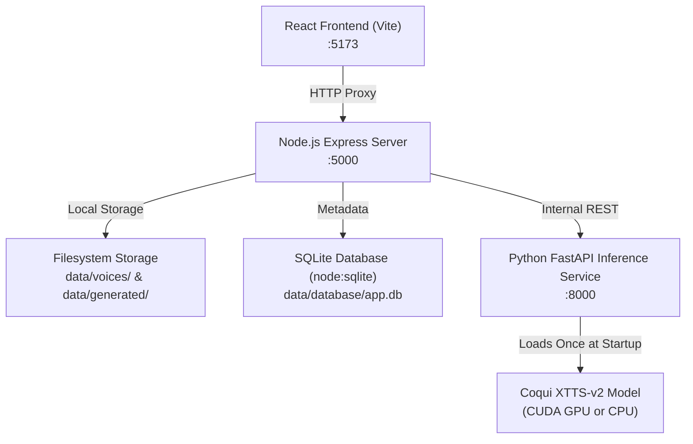

# VoiceForge AI — Local AI Voice Cloning & Text-to-Speech

**VoiceForge AI** is a complete, private, locally runnable zero-shot voice cloning and text-to-speech (TTS) application powered by [Coqui XTTS-v2](https://github.com/coqui-ai/TTS), Node.js/Express, SQLite, and a React + TypeScript frontend.

No external cloud APIs. No paid subscriptions. 100% runs on your local machine.

---

## 🌟 Key Features

1. **Zero-Shot Voice Cloning**: Condition speech generation on a short (3–15 second) reference audio sample without fine-tuning or training.
2. **Audio Sample Upload & In-Browser Recording**: Upload WAV, MP3, FLAC, OGG, or M4A files, or record your voice sample directly with your microphone.
3. **In-Browser Audio Validation & Preview**: Inspect and listen to your voice sample before saving.
4. **Persistent Voice Library**: Save voice profiles to SQLite and reuse them anytime without uploading again.
5. **Multilingual Synthesis (17 Languages)**: XTTS-v2 support for English (`en`), Spanish (`es`), French (`fr`), German (`de`), Italian (`it`), Portuguese (`pt`), Polish (`pl`), Turkish (`tr`), Russian (`ru`), Dutch (`nl`), Czech (`cs`), Arabic (`ar`), Chinese (`zh-cn`), Japanese (`ja`), Hungarian (`hu`), Korean (`ko`), and Hindi (`hi`).
6. **Built-in Audio Player & Scrubber**: Full playback controls with scrub slider, volume adjustment, and re-play.
7. **Direct WAV Download**: One-click download of generated speech files.
8. **Generation History**: Searchable history of past voice synthesis runs with quick playback and deletion.
9. **Consent & Ethics Guard**: Enforced consent confirmation for ethical voice cloning.

---

## 📐 Architecture



---

## 🚀 Quick Start Guide

### Prerequisites

- **Node.js**: v20 or higher (v24 recommended)
- **Python**: 3.10 or 3.11 with `pip`
- **NVIDIA GPU (Recommended)**: CUDA 11.8 or 12.x for fast generation, or CPU mode.

---

### Step 1: Install Python Dependencies

Open a terminal in `python-service/`:
```bash
cd python-service
python -m venv .venv
# Activate venv:
# Windows PowerShell:
.venv\Scripts\Activate.ps1
# Windows CMD:
.venv\Scripts\activate.bat

# Install PyTorch with CUDA (or CPU):
pip install torch torchvision torchaudio --index-url https://download.pytorch.org/whl/cu118

# Install dependencies:
pip install -r requirements.txt
```

### Step 2: Start the Python Inference Service

```bash
cd python-service
python -m uvicorn app.main:app --host 127.0.0.1 --port 8000 --reload
```
*Note: The first time it runs, it will automatically download the XTTS-v2 model weights from Hugging Face.*

### Step 3: Install & Start Backend

In another terminal:
```bash
cd backend
npm install
npm run dev
```
*Backend runs on `http://localhost:5000` with SQLite database initialized at `data/database/app.db`.*

### Step 4: Install & Start Frontend

In a third terminal:
```bash
cd frontend
npm install
npm run dev
```
Open **[http://localhost:5173](http://localhost:5173)** in your browser.

---

### ⚡ One-Click Startup (Windows)

Double click `start.bat` or run:
```powershell
.\start.ps1
```
This automatically launches all three services in separate console windows.

---

## 🔒 Privacy & Safety

- All reference audio and generated speech are stored locally on your hard drive in `data/`.
- No telemetry, analytics, or audio data ever leaves your computer.
